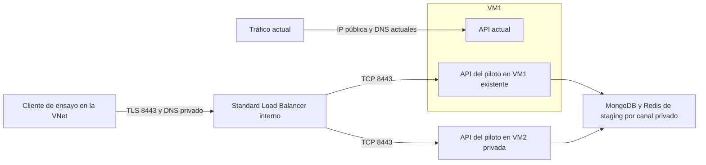

# Piloto privado de dos VMs en Azure

18 de noviembre de 2026 · Propuesta de ejecución para el responsable

La SPEC-018 está aprobada. El piloto de dos VMs tiene autorización para preparación local. Antes de escribir en Azure se requieren la enmienda aplicable a los Art. XIII y XIV, el presupuesto B-6, `what-if` autorizado y la aprobación de la operación concreta. El acceso B-5 está limitado a lectura.

## Topología propuesta



El frontend privado usa una IP distinta y su acceso de prueba requiere ruta y DNS dentro de la VNet. El equipo debe habilitar el destino de VM1 en una IP privada y un bind de staging que puedan coexistir con el acceso actual. El módulo local no cambia la IP pública, el DNS, el NSG, la NIC, los discos ni la VM original. Cualquier cambio requerido en el host o la aplicación de VM1 se presenta aparte para aprobación.

Azure Load Balancer balancea TCP en capa 4. Caddy sigue siendo útil para balancear procesos dentro de una máquina. El piloto de dos VMs separa el fallo de una réplica de API del fallo de un host. MongoDB, Redis y una posible dependencia de salida compartida conservan su propio dominio de fallo.

## VM2 y dependencias de operación

| Decisión | Configuración propuesta | Condición de aceptación |
|---|---|---|
| Región y red | West US 2 si coincide con la VM1 comprobada. NIC privada en VNet y subred verificadas | Confirmar cuota, CIDR, IP libres y alcance del cliente |
| Tamaño | `Standard_B2ats_v2` x86-64 como primera candidata. `Standard_B1s` como alternativa sujeta a disponibilidad y capacidad | Medir CPU, memoria, P95 y tamaño de imagen. Ambas son candidatas de 1 GiB. Detener si la VM1 no admite la réplica temporal o la VM2 no sostiene la carga |
| Imagen y disco | Ubuntu Server 24.04 LTS con imagen y versión confirmadas, Standard SSD LRS E4 de 32 GiB | Confirmar compatibilidad de Trusted Launch, espacio para imagen, Docker y registros. E6 de 64 GiB requiere cálculo explícito |
| Administración | Llave pública dedicada, contraseña SSH deshabilitada, Trusted Launch cuando el SKU e imagen lo soporten. Puerto 22 opcional desde una red privada de administración existente | B-6 debe identificar el operador y el camino de acceso. Conservar la identidad OIDC actual limitada a VM1 |
| Datos | Ambas réplicas usan un MongoDB de staging y un Redis de staging compartidos por un canal privado autenticado, con TLS y DNS que las dos réplicas puedan resolver | El Compose actual encierra ambos servicios en su bridge. Revisar una vía privada aprobada, probar el replica set y verificar que MongoDB y Redis permanezcan sin acceso público |
| TLS | Cada API termina HTTPS y tiene su propia llave y certificado de laboratorio para el SAN del DNS privado | Comprobar cadena, nombre y SNI desde el cliente, sin omitir la validación |
| Distribución | Un frontend interno, un pool de dos IP, una regla TCP de 8443 y sonda HTTPS de salud | Abrir conexiones TCP nuevas desde un cliente independiente. Cruzar `DipAvailability` y `VipAvailability` con el estado y la latencia por destino. Capturar identificadores sintéticos en los registros de cada API. Usar distribución predeterminada por cinco campos sin afinidad de cliente. La sonda de vida por sí sola no acredita escritura en MongoDB |
| Egreso | Entrega de imagen y paquetes desde un acceso o relay privado que ya exista y esté aprobado. Preparar copia de imagen por digest y desactivar servicios externos que no participen en el ensayo | El ILB carece de reglas de egreso. Azure documenta una excepción de salida predeterminada para pools por IP en subredes que aún la admiten. Confirmar el comportamiento y egreso de VM1 y VM2, y cotizar cualquier egreso nuevo antes de crear recursos |

La plantilla aprovisiona Ubuntu, red y balanceo. La puesta en marcha de Docker y de la API queda como paso de operación del piloto. Desde el acceso privado aprobado, instalar Docker desde el origen aprobado, verificar el artefacto firmado y cargar la API por digest. Configurar staging con el Compose aprobado, certificados locales y acceso privado a datos. Confirmar las dos respuestas directas a `/readyz` y la validación TLS antes de iniciar pruebas por el frontend. Si falta distribución de artefactos o datos de staging, la VM se considera aprovisionada sin réplica funcional.

El ensayo de sesiones usa datos sintéticos y una llave JWT dedicada de staging, instalada por el mecanismo autorizado en ambos hosts. La rotación y el rollback de la réplica nueva se planifican aparte. Evitar bases independientes en pruebas de logout, refresh y escrituras. Si el canal de datos sigue bloqueado, limitar cualquier demostración autorizada a reparto de tráfico sintético y conservar abierto el criterio de réplica funcional.

Fuentes: [Egreso de Azure](https://learn.microsoft.com/en-us/azure/virtual-network/ip-services/default-outbound-access) · [Conectividad de Standard ILB](https://learn.microsoft.com/en-us/troubleshoot/azure/load-balancer/troubleshoot-common-problems/no-outbound-connectivity-standard-internal-load-balancers) · [Sondas](https://learn.microsoft.com/en-us/azure/load-balancer/load-balancer-custom-probe-overview) · [Pools por IP](https://learn.microsoft.com/en-us/azure/load-balancer/backend-pool-management)

## Presupuesto incremental

La captura histórica muestra **USD 198,33 de crédito**, **USD 1,70 de gasto mensual** y **14 días restantes**. La consulta actual debe confirmar saldo, vigencia, gasto, tipo de suscripción, límite de gasto efectivo y cuotas. La referencia histórica no se usa para autorizar recursos.

| Componente nuevo | Referencia pública USD |
|---|---:|
| VM2 Linux `Standard_B2ats_v2` | 0,0094/h |
| Alternativa Linux `Standard_B1s` | 0,0104/h |
| Standard SSD E4 32 GiB | 2,40/mes, equivalente a ~0,00329/h usando 730 h |
| Standard SSD E6 64 GiB | 4,80/mes, equivalente a ~0,00658/h |
| Operaciones Standard SSD LRS | 0,002 por 10 000 |
| Standard LB de 1 a 5 reglas | 0,025/h facturable |
| Datos procesados por el LB | 0,005/GB |
| VM1, IP pública y disco existentes | Gasto base. Se verifica aparte |
| Nueva IP pública, NAT, balanceador L7, otra subred administrada | Fuera de la propuesta base. Cotizar y autorizar si se vuelven indispensables |

Una ventana **propuesta de 4 horas transcurridas** reserva 5 horas facturables de VM2, disco y LB, 1 GB procesado y 100 000 operaciones de disco. Estimación para B2ats_v2 y E4: `0,047 + 0,0164 + 0,125 + 0,005 + 0,020 = USD 0,2134`. Una ventana de 2 horas usando 3 horas facturables cuesta aproximadamente USD 0,1381 con los mismos límites de volumen. Añadir **USD 3 de reserva** para variación y cargos diferidos. El sobre de 4 horas queda en **USD 3,22 redondeados**, más transferencia, impuestos u otros cargos asociados que se deberán confirmar. El total aprobado, incluyendo los asociados y la reserva, debe quedar dentro de USD 15.

Con la referencia PAYG y sin crédito o descuento, dejar VM2, E4 y el LB con regla durante 730 horas costaría **USD 27,51** antes de datos y operaciones. Desasignar la VM detiene su cómputo según el estado de facturación, pero el disco y el LB pueden seguir generando cargo. Las alertas de Azure Budgets pueden llegar con retraso y solo notifican.

Fuentes: [Tarifas públicas de VM en West US 2](https://prices.azure.com/api/retail/prices?$filter=armRegionName%20eq%20%27westus2%27%20and%20serviceName%20eq%20%27Virtual%20Machines%27%20and%20priceType%20eq%20%27Consumption%27%20and%20%28armSkuName%20eq%20%27Standard_B1s%27%20or%20armSkuName%20eq%20%27Standard_B2ats_v2%27%29) · [Discos administrados](https://azure.microsoft.com/en-us/pricing/details/managed-disks/) · [Load Balancer](https://azure.microsoft.com/en-us/pricing/details/load-balancer/) · [Presupuestos](https://learn.microsoft.com/en-us/azure/cost-management-billing/costs/tutorial-acm-create-budgets)

## Estado de la consulta B-5 al 18 de noviembre de 2026

El responsable confirmó MFA y autorizó reintentar la lectura. El perfil local mostraba una suscripción habilitada. La solicitud de inventario a Resource Manager devolvió `AADSTS50076`, que exige renovar la sesión de Azure CLI con MFA. Saldo, vencimiento, gasto, oferta, límite de facturación, cuotas, región y características de VM1 siguen sin verificar. El presupuesto de esta propuesta usa únicamente tarifas públicas. No se solicitó `what-if` ni se modificaron recursos.

Para retomar la consulta, el responsable inicia sesión de forma interactiva en Azure CLI con el tenant de VAIVÉN y el scope indicado por el error (`https://management.core.windows.net//.default`). La lectura del grupo esperado confirma que la sesión CLI está lista. Repetir el inventario con B-5 antes de llenar los parámetros del piloto.

## Corte B-5 y criterios para autorizar

El reintento del 18 de noviembre de 2026 a las 14:22, hora de Ciudad de México, recibió `AADSTS50076` en el GET del grupo esperado. El perfil habilitado en caché solo acredita que Azure CLI conoce una suscripción. Identidad de VAIVÉN, acceso efectivo ARM y facturación siguen sin confirmar. No se generaron parámetros con infraestructura real.

El responsable luego comunicó `westus2` como resultado de `az group show --name rg-vaiven --query location -o tsv`. Se registra como ubicación reportada del grupo. Las ubicaciones de VM1, la red y los discos se verifican por separado. A las 21:21, hora de Ciudad de México, el GET desde la sesión CLI de este entorno volvió a devolver `AADSTS50076`. La sesión usada por el responsable respondió, pero este entorno aún no tiene acceso ARM de lectura. Se conserva la referencia de precios de West US 2 hasta comprobar la región de VM1 y VNet. Saldo, vencimiento, gasto, cuotas y SKU continúan pendientes. No se ejecutó `what-if`.

| Lectura | Evidencia que debe quedar en el expediente restringido |
|---|---|
| Cuenta, alcance y permisos | Tenant y suscripción contrastados con el responsable. GET del grupo objetivo y comprobación de lectura en cada ámbito. Los permisos de facturación se verifican por separado |
| Recursos existentes | VM1 con SKU, SO, región y estado; VNet, subredes, ruta, NIC, NSG, IP pública, discos y servicios compartidos. Confirmar disponibilidad de ambas IP nuevas y compatibilidad de VM1 con el pool por IP |
| Capacidad | SKU de VM2 sin restricciones para suscripción y región objetivo, más dos vCPU libres en la cuota regional y de familia. La capacidad física de asignación solo se confirma al crear bajo autorización |
| Facturación | Oferta, crédito y vencimiento de la fuente de facturación; gasto acumulado, desglosado de VM1, disco e IP. La consulta de costos no sustituye la consulta de crédito. Conciliar relay, transferencias, operaciones e impuestos |

El 18 de noviembre se consultó el catálogo público. Se confirmaron VM Linux de West US 2 a USD 0,0094/h, E4 a USD 2,40/mes, operaciones a USD 0,002 por 10 000 y los medidores pagados del balanceador a USD 0,025/h y USD 0,005/GB. El catálogo también distingue un medidor «Disk Mount» del E4. Confirmar su aplicabilidad a este disco del SO y el precio de cualquier cargo asociado con la oferta real. El escenario de referencia usa USD 0,03769 por hora en cómputo, disco y una regla del balanceador, más datos y transacciones. Se reservan USD 3 para contingencia y como máximo USD 11,78 adicionales para asociados hasta que exista una cotización respaldada por cuenta. Descubrir una nueva IP pública, NAT, relay de pago o cambios de topología obliga a volver a cotizar. Como referencias de permanencia accidental antes de datos y operaciones, 24 horas equivalen a USD 0,91, siete días a USD 6,34 y 730 horas a USD 27,51. Si se desasigna VM2 y quedan el disco y el balanceador durante 730 horas, la referencia es USD 20,65.

## Resultado esperado de what-if

Con el Bicep existente y parámetros aprobados, la evaluación local sintética predice NSG, NIC, VM2 y Standard Load Balancer interno. El disco E4 lo crea el proveedor como disco del SO y puede no aparecer como fila separada. Las operaciones anidadas de ARM pueden aparecer como registros de despliegue. El criterio de aceptación es revisar cada identificador y cada propiedad de red, rechazar modificaciones, reemplazos o eliminaciones de recursos existentes y resolver cualquier diagnóstico o cambio omitido antes de pedir autorización de creación. La red y subred se referencian como existentes. La plantilla tampoco instala la API. [Documentación de what-if](https://learn.microsoft.com/en-us/azure/azure-resource-manager/bicep/deploy-what-if)

La sonda debe obtener HTTP 200 de `/healthz` sobre HTTPS en 8443, desde `AzureLoadBalancer`, con SHA-256 o superior en toda la cadena. Repetir con una conexión que no dependa de SNI y verificar por separado la cadena y el nombre del DNS privado como cliente. Si VM1 carece de un listener de staging compatible y de rutas ya permitidas para cliente y sonda, detener el piloto. Cualquier preparación de VM1 requiere una decisión aparte. Antes y después del ensayo comparar el acceso público actual con las mismas verificaciones de TLS y salud. [Sondas de Azure](https://learn.microsoft.com/en-us/azure/load-balancer/load-balancer-custom-probe-overview)

## Enmienda propuesta para revisión del equipo

Autorizar una excepción temporal a la topología de una VM y una réplica de los Art. XIII y XIV para un piloto privado de staging de SPEC-018. Delimitar una VM adicional y un Standard Load Balancer interno, una ventana de hasta cuatro horas y un máximo incremental total de USD 15 sujeto a B-6 y a la aprobación expresa de los recursos, el presupuesto y el retiro. Mantener el acceso público actual. Aprobar por separado cualquier preparación de VM1 y del canal privado de staging para MongoDB y Redis. Acotar la excepción a recursos de ensayo y cerrarla al verificar su eliminación. La propuesta queda pendiente de decisión del equipo.

## Migración, reversión y retiro

1. Capturar un inventario de solo lectura de datos operativos, red y costos. Confirmar cuotas, salida de VM2, certificados, canal de datos y acceso privado. Comprobar que los nombres derivados del sufijo no existan y que las IP privadas estén disponibles. Guardar IDs y configuración inicial en un registro operativo de acceso restringido.
2. Obtener autorización de `what-if`. Usar modo incremental. Esperar solo la creación de los recursos del piloto. Detenerse si aparecen reemplazos, cambios o eliminaciones de VM1, NIC, IP pública, NSG, DNS, discos o recursos de datos existentes. Conservar los parámetros aprobados fuera del repositorio. En PowerShell, tras las autorizaciones, ejecutar `az deployment group what-if --resource-group $pilotResourceGroup --mode Incremental --parameters $approvedPilotParameterFile`.
3. En una ventana de staging autorizada, crear únicamente los recursos aprobados y registrar hora e identificadores. Probar cada API directa por su TLS privado, después el ILB desde un cliente independiente. Demostrar reparto, exclusión de una réplica de ensayo, recuperación, sesiones y escrituras cruzadas, 69 operaciones, gzip y ausencia de exposición pública de los datos. Mantener el acceso actual para clientes.
4. Reservar la última hora de las 4 para reversión y retiro. Si una prueba supera las tres primeras horas, cerrarla como incompleta. Detener tráfico de ensayo, conservar evidencia y confirmar `/healthz`, `/readyz` y `/api/v1/meta` en el acceso actual. Restaurar solo las configuraciones que el piloto haya cambiado con aprobación. Cualquier futura migración de datos reales debe resolver reconciliación y restauración antes del corte.
5. Retirar el LB del piloto, VM2, NIC, NSG y disco del piloto según el inventario aprobado. Comprobar también que la reserva de frontend privado se liberó y que los costos diferidos cierran. Las etiquetas ayudan a identificar y verificar pertenencia. El borrado requiere confirmar los IDs, no basta una coincidencia de etiqueta.

La repetición en Podman comprobó caída, recuperación y retiro del ensayo. Tras el reparto 8/8, 0/12 y 8/8, el arnés verificó cero contenedores y cero redes con la etiqueta exclusiva de esa ejecución. Esto acredita la reversión y limpieza locales. Quedan por comprobar la sonda TLS de Azure, la ruta privada de datos y la continuidad de la entrada pública en la infraestructura real.

El corte de tráfico real se evalúa en una fase posterior. Conservar DNS, IP pública y acceso directo durante el piloto evita interrumpir el servicio actual.

## Resultado de la lectura B-5 (2026-11-18, Cloud Shell del responsable)

Consultas de solo lectura ejecutadas por el responsable. No se creó ni modificó nada.

| Dato | Resultado | Consecuencia para el piloto |
|---|---|---|
| Región | `westus2` para el grupo, VM1, VNet, NSG, IP pública, NIC y disco del SO | Precios de referencia de West US 2 confirmados |
| Recursos existentes | Una VM (`vm-vaiven`), su NIC, NSG, IP pública, disco del SO y VNet. Sin balanceadores ni otras VMs | El piloto solo agrega recursos; el what-if no debe mostrar cambios a estos seis |
| VM1 | `Standard_B2ats_v2`, encendida | VM2 del mismo tamaño |
| Disponibilidad del SKU | `NotAvailableForSubscription` solo de tipo **Zone** (zonas 1, 2 y 3) | Se puede crear sin zona, como VM1. `infra/pilot.bicep` no pide zonas: **no bloquea** |
| Cuota regional | 2 de 4 vCPU | VM2 la deja en **4/4**, sin margen para otra VM durante el piloto |
| Cuota de la familia Basv2 | 2 de 4 vCPU | Igual: cabe justa |
| Red | VNet `10.0.0.0/16` con una subred `vm-vaivenSubnet` (`10.0.0.0/24`) | VM2 y el frontend privado del balanceador en esa subred, con IPs estáticas libres que se confirman en el what-if |
| Gasto | `az consumption usage list` devuelve el costo vacío en esta cuenta | Saldo, vencimiento y gasto: **pendientes**, se leen en el portal (Cost Management) |

**Estado:** inventario, región, cuota y SKU **verificados**. B-6 (presupuesto) sigue pendiente hasta tener el saldo y el vencimiento del crédito. Sin eso no se pide el what-if.

## Presupuesto verificado (2026-11-18, portal de Azure del responsable)

| Dato | Valor |
|---|---|
| Créditos disponibles | **USD 198,21** |
| Gasto del mes | USD 1,79 |
| Vencimiento del crédito | En **14 días** (hacia el 2026-12-02) |
| Límite de gasto | Activo: el portal indica que los servicios **se pausan** al agotar o vencer el crédito, sin cobro a tarjeta |

**Cálculo con la regla del piloto** (no superar el crédito disponible menos el 20 % de reserva):

| Concepto | USD |
|---|---|
| Crédito disponible menos el 20 % | 158,57 |
| Consumo actual proyectado hasta el vencimiento (USD 1,79 en 18 días ≈ 0,10/día × 14) | ≈ 1,40 |
| Piloto de 4 horas (estimación con tarifas públicas, con contingencia) | 3,22 |
| **Total proyectado** | **≈ 4,62** |
| Tope incremental propuesto para el piloto | 15,00 |

**Resultado:** el piloto **cabe con amplio margen**: ≈ 4,62 frente a 158,57 disponibles y por debajo del tope de 15. Riesgo de cargo fuera del crédito: bajo, porque el límite de gasto está activo. Aun así, el retiro de los recursos del piloto es obligatorio al terminar la ventana.

**Riesgo operativo ajeno al piloto:** cuando el crédito venza (≈ 2026-12-02), **todos** los servicios de la suscripción se pausan, incluidas VM1 (staging y producción). Hay que decidir antes de esa fecha si se actualiza la suscripción a pago por uso o se migra. Es una decisión del responsable y del equipo.

**Estado de B-6:** datos verificados. Falta la **aprobación** del presupuesto por el equipo.

## What-if del piloto (2026-11-19, aprobado por el equipo; lo ejecuta el responsable)

El what-if **no crea nada**: muestra lo que haría el despliegue. Se ejecuta en Azure Cloud Shell (Bash). Los parámetros se guardan **fuera del repositorio**, en el `$HOME` de Cloud Shell.

```bash
# 1. Código del piloto (develop, público)
git clone --depth 1 --branch develop https://github.com/VaivenEnterprise/VaivenApplication-Backend.git ~/vaiven && cd ~/vaiven

# 2. Inventario que hace falta
VM1_IP=$(az vm list-ip-addresses -g rg-vaiven -n vm-vaiven --query "[0].virtualMachine.network.privateIpAddresses[0]" -o tsv); echo "$VM1_IP"
az network vnet check-ip-address -g rg-vaiven -n vm-vaivenVNET --ip-address 10.0.0.10 --query available
az network vnet check-ip-address -g rg-vaiven -n vm-vaivenVNET --ip-address 10.0.0.20 --query available
IMG=$(az vm image list --publisher Canonical --offer ubuntu-24_04-lts --sku server --location westus2 --all --query "[-1].version" -o tsv); echo "$IMG"

# 3. Llave SSH solo para VM2 (la privada nunca sale de Cloud Shell)
[ -f ~/.ssh/vaiven_pilot ] || ssh-keygen -t ed25519 -N '' -f ~/.ssh/vaiven_pilot -C vaiven-pilot

# 4. Parámetros (fuera del repositorio)
jq -n --arg ip "$VM1_IP" --arg img "$IMG" --arg key "$(cat ~/.ssh/vaiven_pilot.pub)" \
  --arg exp "$(date -u -d '+4 hours' +%Y-%m-%dT%H:%M:%SZ)" \
  '{suffix:"p1", location:"westus2", expiresAtUtc:$exp, vnetName:"vm-vaivenVNET", subnetName:"vm-vaivenSubnet",
    existingVmPrivateIp:$ip, pilotVmPrivateIp:"10.0.0.10", frontendPrivateIp:"10.0.0.20",
    clientSourceCidr:"10.0.0.0/24", mongoPrivateIp:$ip, redisPrivateIp:$ip,
    vmSize:"Standard_B2ats_v2", osDiskSizeGb:32, osDiskSku:"StandardSSD_LRS",
    imageSku:"server", imageVersion:$img, adminUsername:"vaivenadmin", sshPublicKey:$key}' > ~/pilot.json

# 5. What-if (solo muestra cambios)
az deployment group what-if -g rg-vaiven --mode Incremental -f infra/pilot.bicep \
  --parameters environment=staging enablePilot=true inventoryAndBudgetConfirmed=true pilot=@$HOME/pilot.json
```

**Criterio de aceptación del what-if:**
- solo aparecen **creaciones** (`+ Create`) de recursos `vaiven-pilot-p1-*`: NSG, NIC, VM, disco y balanceador interno;
- **cero** `Modify`, `Delete` o `Replace` sobre `vm-vaiven`, su NIC, NSG, IP pública, disco, VNet o subred;
- si aparece cualquier otra cosa, se detiene.

**Antes de crear (cambios en VM1, aprobación aparte):** VM2 solo podrá ejecutar la API si:
1. VM1 publica MongoDB y Redis **solo en su IP privada**, con autenticación, y su NSG solo admite a `10.0.0.10`. MongoDB se conecta con `directConnection=true`, porque el replica set anuncia el nombre interno `mongo:27017`.
2. VM2 tiene de dónde instalar Docker y descargar la imagen firmada. Su NSG niega toda salida salvo MongoDB, Redis y DNS, así que hace falta un relevo de artefactos en VM1 (`artifactRelayPrivateIp`) o abrir la salida de forma temporal.

Los dos cambios tocan la VM que también aloja producción: se presentan y se aprueban por separado. Sin ellos, el balanceador puede crearse, pero la sonda `/healthz` de VM2 fallará y **no** habrá dos réplicas reales.

## Resultado del what-if (2026-11-19, Cloud Shell del responsable)

- **Imagen:** `24.04.202611170` (resuelta con `az vm image show … :latest`; `[-1]` de la lista devolvía una versión no publicada).
- **Resultado:** **4 a crear y 6 a ignorar.** Se crean `vaiven-pilot-p1-vm`, `-nic`, `-nsg` y `-lb`; el disco del SO va dentro de la VM y se borra con ella. VM1, su disco, NIC, NSG, IP pública y VNet quedan como `Ignore`: **ningún** cambio sobre recursos existentes. **Cumple el criterio de aceptación.**
- **Balanceador:** interno en `10.0.0.20`; backends VM1 y VM2 por IP; sonda HTTPS `/healthz` cada 15 s con 2 fallos; regla TCP 8443 → 8443.
- **Hallazgo para la creación:** el NSG de VM2 abre la salida a MongoDB (27017) y Redis (6379) **directo** en VM1, lo que corresponde a la opción B (publicar las bases), que está descartada. Con la pasarela mTLS recomendada (opción A), esas reglas pasan a 27018 y 6380 y se agrega la salida a `Storage.WestUS2:443` para el relevo de la imagen. Hay que ajustar el Bicep y repetir el what-if antes de crear.
- **La ventana de 4 h** (`expiresAtUtc`) se recalcula al momento de crear: hay que regenerar `pilot.json` justo antes.

## Ejecución del piloto (2026-11-19 y 20, Cloud Shell del responsable)

Creado con `az deployment group create` (mismos parámetros que el what-if) y operado con `scripts/pilot/pilot.sh` (`ca`, `vm1-up`, `vm2-up`, `down`).

**Fallas encontradas y corregidas durante la ejecución:**

| Falla | Causa | Corrección |
|---|---|---|
| El despliegue falló con `SecurityRuleInvalidAccessType` | La etiqueta `AzurePlatformDNS` solo admite *Deny* | Se quitó la regla; `verify-pilot-iac.mjs` rechaza toda regla *Allow* con etiquetas `AzurePlatform*` |
| `vm1-up` no devolvía la solicitud de certificado | `install -o 65532` (ese usuario no existe en la VM) y `run-command` ejecuta el guion con `sh`, que no admite `pipefail` | `chown` numérico y `#!/usr/bin/env bash` antepuesto en `vm_run` |
| `vm2-up` recibía 404 del relevo | Los `.deb` de Docker llevan `%3a` en el nombre | El cliente codifica `%` como `%25` |
| **0 respuestas por el balanceador** | El grupo de backends quedó **vacío**: las direcciones por IP escritas dentro del balanceador se descartaron al crearlo, aunque el what-if las mostraba. VM2 no recibía sondas | En el piloto se agregaron con `az network lb address-pool address add`. En el Bicep pasan a un recurso hijo `backendAddressPools`, y los dos verificadores exigen esa forma |

**Resultados:**

| Prueba | Resultado |
|---|---|
| Datos de VM2 por la pasarela mTLS | `/readyz` de VM2: `ready`, `redis: ok`. Relevo verificado por sha256; imagen idéntica a la verificada por firma en VM1 |
| Sesión entre VMs (C-12) | Token emitido en VM1 → `/me` en VM2: 200. Logout en VM2: 204. El mismo token en VM1: **401 en 43 ms** |
| Salud de los dos backends (API de salud por regla) | `up: 2`, los dos `Up_Probe_Success`; los dos reciben la sonda `/healthz` (≈ 4–5 por minuto) |
| Reparto desde VM1 (20 peticiones al frontend del balanceador) | 15 atendidas por VM2 (contadas en su registro) y 5 sin respuesta, asignadas a VM1 misma (*hairpin*, ver abajo) |
| Exclusión | API de VM2 detenida: a los 45 s, VM2 `Down_Probe_HttpEndpointUnreachable` y `up: 1` |
| Recuperación | Tras reiniciar la API de VM2, 20/20 respuestas 200 desde VM1, ninguna atendida por VM1: VM2 volvió a recibir tráfico. Se midió por tráfico en el primer ciclo de parada; el segundo ciclo, medido con la API de salud, no se volvió a consultar antes del retiro |

**Límite del método:** Azure Load Balancer interno no admite *hairpin*. Si un backend se conecta al frontend y el flujo se asigna a sí mismo, la conexión se pierde. El único cliente fue VM1 (cuota de 4/4 vCPU, sin una tercera VM), así que el reparto se mide por los registros de cada backend y la salud por la API del balanceador, no por un cliente neutral.

**Retiro (en la ventana de 4 h):**
- `pilot.sh down` quitó la pasarela y el relevo de VM1 (MongoDB y Redis sin cambios) y borró la CA de Cloud Shell;
- se borraron por ID los 5 recursos etiquetados: balanceador, VM2, su disco, su NIC y su NSG;
- verificación: no queda ningún recurso `spec-018-pilot` ni `vaiven-pilot*`; en VM1, 0 contenedores del piloto y 0 puertos 27018, 6380 u 8444;
- costo real (lectura del responsable en el portal, 2026-11-21): gasto del mes de USD 2,10 y crédito disponible de USD 197,90, frente al estimado de ≈ USD 3,20 (tope de USD 15); la diferencia contra la lectura del 2026-11-18 (≈ USD 1,8) es de ≈ USD 0,30 e incluye el piloto y la base normal de VM1, y no queda costo residual porque no sobrevive ningún recurso del piloto;
- *Cost Management* puede tardar de 24 a 72 h en reflejar el consumo: se recomienda volver a leer el gasto después del 2026-11-23.
