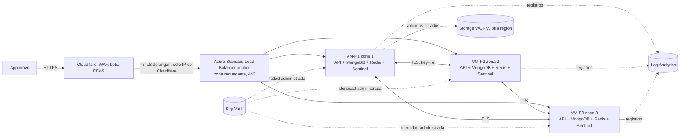

# Plan hacia seguridad de nivel bancario y balanceador permanente

- **Fecha:** 2026-11-20 · **Estado:** **propuesta**. No está aprobada ni se ejecutó nada (Art. I).
- **Autor:** BE-B, a pedido del responsable.
- **Punto de partida:**
  - matriz de la spec 018: 9 de 10 controles obligatorios;
  - lista amplia de 24 prácticas: **≈ 73 %** (17,5 de 24).
- **Meta:** 24 de 24 con evidencia (**100 % de la lista**), más OWASP ASVS 4.0.3 **nivel 2** completo y **nivel 3** en autenticación, sesiones y criptografía.
- **Advertencia:** ningún sistema es «100 % seguro». El 100 % significa que **todas las prácticas de la lista están implementadas y validadas con evidencia**, revisadas cada trimestre.

Este documento se convierte en specs (019 a 022, §9) con `spec-writer`. Cada spec se aprueba, se implementa y se despliega como cualquier otra.

## 1. Decisión previa (bloqueante)

Casi todo lo de nivel bancario **cuesta dinero mensual**. Hoy la cuenta es la gratuita (Art. XIII.1) y el crédito vence cerca del **2026-12-02**.

| Decisión | Quién | Si no se toma |
|---|---|---|
| Pasar la suscripción a **pago por uso** con presupuesto y alertas de costo | Responsable (dueño de la cuenta) | Solo son posibles las fases A y B (§4), que cuestan ≈ USD 0. El 100 % no es alcanzable |
| Comprar un **dominio propio** (≈ USD 10–15 al año) | Responsable | No hay WAF de borde ni HSTS preload; el certificado sigue ligado a `cloudapp.azure.com` |
| **Enmiendas** a la constitución (§8) | Equipo (Art. XI) | Las fases C a E contradicen los Art. XIII.1, XIII.6, XIV.1 y XIV.4 |
| Ventana para el **pentest externo** y su presupuesto | Responsable | El punto 23 queda en 0,5 (solo pentest interno) |

## 2. Brechas que faltan para el 100 %

| # | Práctica (lista de 24) | Hoy | Qué falta | Fase |
|---|---|---|---|---|
| 11 | Bóveda de secretos | 0,5 | Key Vault con identidad administrada; fuera los `.env` con secretos en la VM | B |
| 14 | MFA | 0 | TOTP, códigos de recuperación y *step-up* en operaciones sensibles | A |
| 16 | Cabeceras, TLS y HSTS | 0,5 | HSTS en producción (y preload con dominio propio) | B / D |
| 17 | Eventos y alertas | 0,5 | Recepción confirmada, suplente, guardia y simulacros | A |
| 18 | Observabilidad | 0,5 | Registros centralizados (Log Analytics), tableros y reglas de alerta | C |
| 19 | Cifrado interno en tránsito | 0,5 | TLS en MongoDB y Redis, usuarios con mínimo privilegio | C |
| 21 | Alta disponibilidad | 0 | Balanceador permanente, 2 o más réplicas de API y datos replicados (§5) | E |
| 22 | WAF, DDoS de capa 7 y bots | 0 | Borde con WAF administrado y protección contra bots | D |
| 23 | Pentest y fuzzing | 0 | Fuzzing nativo de Go, ZAP autenticado completo y pentest externo | A / F |

Además, hay prácticas bancarias **que la lista de 24 no medía**. Se agregan porque un auditor de banca las pediría:
- separar producción de staging en máquinas distintas;
- bitácora de auditoría inmutable;
- cifrado de datos personales por campo;
- JWT asimétrico con rotación de llaves;
- revisión trimestral de accesos;
- separación de funciones.

## 3. Prácticas bancarias propuestas, por dominio

### 3.1 Identidad y acceso de usuarios

| Práctica | Diseño para VAIVÉN | Criterio de aceptación |
|---|---|---|
| **MFA TOTP** (RFC 6238) | Alta con secreto cifrado (§3.3) y código QR; códigos de recuperación de un solo uso (hash argon2id); **obligatoria para administradores**, opcional y recomendada para usuarios. Implementación con la biblioteca estándar (HMAC-SHA1), sin dependencias nuevas | Login de admin sin TOTP → 401; ventana de ±1 paso; reutilizar un código → rechazado; prueba de fuerza bruta limitada |
| **Step-up** | Pedir TOTP o contraseña reciente (≤ 5 min) para: cambiar correo o contraseña, borrar la cuenta, confirmar pagos, sancionar y cerrar incidencias | Las rutas sensibles sin *step-up* → 401 con `step_up_required` en el contrato |
| **Gestión de sesiones por dispositivo** | `GET /me/sessions` y `DELETE /me/sessions/{id}`; vida absoluta de 30 días para el refresh; aviso push y correo por inicio de sesión desde un dispositivo nuevo | Revocar un dispositivo invalida su access token en ≤ 60 s (ya medido: 43 ms) |
| **Bloqueo progresivo y anti-bots** | Demora exponencial por cuenta y por IP (ya hay límite); CAPTCHA (Cloudflare Turnstile, gratuito) tras 3 fallos y en el registro | Prueba de carga de credenciales: el éxito tras el bloqueo es 0 |
| **Contraseñas comprometidas** | Comparar contra una lista local de las 100 000 más filtradas (sin servicio externo); opcional, HIBP por *k-anonymity* | Las contraseñas de la lista se rechazan al registrar o cambiar |
| **Integridad del dispositivo** (opcional) | Verificar el veredicto de **Play Integrity** en el registro y el login (Android) | Un APK modificado o un emulador no pasa |

Dueño sugerido: **BE-A** (auth, spec 003) con móvil. Requiere contrato nuevo (Art. IV).

### 3.2 Tokens y criptografía

| Práctica | Diseño | Aceptación |
|---|---|---|
| **JWT asimétrico con `kid`** | Pasar de HS256 (secreto compartido) a **ES256** con `kid`. La llave privada vive en Key Vault; la pública se publica en un JWKS interno. Rotación cada 90 días sin corte: dos llaves válidas durante el traslape | Token con `kid` desconocido → 401; rotación en staging sin sesiones caídas |
| **Inventario criptográfico** | Tabla de algoritmos, llaves, dueño, ubicación y fecha de rotación | Revisado cada trimestre |
| **TLS** | TLS 1.2 como mínimo con suites AEAD; 1.3 preferido. HSTS en producción `max-age=31536000; includeSubDomains`, y *preload* con dominio propio | SSL Labs: **A+** |

### 3.3 Datos

| Práctica | Diseño | Aceptación |
|---|---|---|
| **Cifrado de datos personales por campo** | Cifrado de sobre: AES-256-GCM por campo (teléfono, dirección, secreto TOTP) con una DEK por colección, envuelta por una KEK en **Key Vault**. Para buscar por correo, índice ciego con HMAC | Un volcado de MongoDB no muestra datos personales en claro; prueba de rotación de la KEK |
| **TLS y mínimo privilegio en MongoDB** | `--tlsMode requireTLS`, SCRAM-SHA-256; usuario de la app con `readWrite` solo en su base; usuario de respaldo aparte; *keyFile* o x509 entre los miembros del replica set | Conexión sin TLS → rechazada; el usuario de la app no puede `dropDatabase` |
| **TLS y ACL en Redis** | `rediss://`, usuario ACL con solo los comandos usados (`GET`, `SET`, `INCR`, `PEXPIRE`, `EVALSHA`, `DEL`, `PING`) | `FLUSHALL` y `CONFIG` → `NOPERM` |
| **Cifrado en reposo** | Cifrado del servidor de Azure (ya activo) más *encryption at host*; llaves administradas por el cliente (CMK) en Key Vault para los discos de producción | Configuración visible en Defender for Cloud |
| **Respaldos inmutables** | Volcados cifrados a Azure Storage con política de **inmutabilidad (WORM)** de 30 días, en otra región; restauración de prueba mensual | RPO ≤ 1 h, RTO ≤ 4 h, con evidencia del simulacro |
| **Privacidad (LFPDPPP)** | Inventario de datos personales, plazos de retención, derechos ARCO y aviso de privacidad alineado | Matriz de datos aprobada |

### 3.4 Secretos

- **Azure Key Vault** (Standard, centavos al mes), con **identidad administrada** de cada VM. La API lee sus secretos al arrancar: Mongo, Redis, Cloudinary, IA, push y la llave JWT. En la VM solo quedan las variables no secretas.
- Calendario de rotación:
  - llave JWT cada 90 días;
  - contraseñas de bases cada 180 días;
  - claves de IA antes del 2027-02-15.
- GitHub: *secret scanning* con **push protection** (gratuito en repositorios públicos). OIDC hacia Azure ya existe; quitar todo secreto de larga vida que quede en Actions.
- **Aceptación:** `grep` de secretos en la VM devuelve 0. Rotación de prueba sin corte.

### 3.5 Perímetro

- **Opción recomendada, de bajo costo:**
  - dominio propio detrás de **Cloudflare** (plan gratuito): WAF con reglas administradas, DDoS de capa 3, 4 y 7, Turnstile y límite de tasa en el borde;
  - **Authenticated Origin Pulls** (mTLS de Cloudflare al origen) y un NSG que **solo** admite los rangos de Cloudflare en el 443 del balanceador.
- **Opción Azure nativa:** Application Gateway WAF_v2 o Front Door Premium. Cuesta ≈ USD 300–350 al mes solo por la base: fuera de proporción para el proyecto.
- **Cambio de regla:** las dos opciones meten un intermediario TLS, así que requieren enmendar el Art. XIV.4 (§8).
- **Otros:** `security.txt`, vigilancia de los registros de Certificate Transparency y *rate limit* por usuario además del límite por IP.
- **Aceptación:**
  - una petición directa al origen sin el certificado de Cloudflare → rechazada;
  - las reglas OWASP del WAF bloquean las cargas de prueba de ZAP;
  - SSL Labs A+.

### 3.6 Detección y respuesta

| Práctica | Diseño | Aceptación |
|---|---|---|
| **Registros centralizados** | Azure Monitor Agent → **Log Analytics** (los primeros 5 GB al mes son gratuitos; retención de 90 días). Solo los registros estructurados ya saneados | Consulta KQL de los eventos `auth.*` de las dos réplicas |
| **Reglas de alerta** | Las 6 alertas de la spec 018 pasan a reglas de Log Analytics: login fallido en masa, reutilización de refresh, 403 en ráfaga, 5xx y revocación caída. Se suma «inicio de sesión de admin» | Simulacro: aviso en ≤ 5 min |
| **Bitácora de auditoría inmutable** | Colección `audit_log` de solo anexar, con **cadena de hash** (cada registro lleva el hash del anterior) para las acciones de admin, sanciones, pagos, cambios de cuenta y accesos a datos personales. Copia diaria al almacenamiento WORM | Alterar un registro rompe la verificación de la cadena |
| **Guardia** | Titular `JosephYanez27` más un **suplente**; recepción confirmada; simulacro de mesa cada trimestre | Acta del simulacro |
| **Defender for Cloud** | CSPM básico (gratuito): **puntuación segura** como métrica del entorno de Azure | Puntuación ≥ 90 % |

### 3.7 Cadena de suministro y proceso

- **SLSA nivel 3:** procedencia con *artifact attestations* de GitHub, además de la firma de cosign actual.
- **Commits firmados** obligatorios y **2 revisores** para `main` (regla de ramas).
- **Separación de funciones:** quien escribe un cambio no aprueba ni despliega producción. Hay 4 personas, así que es posible.
- **Accesos:**
  - revisión trimestral de los accesos de Azure, GitHub, Cloudinary y Better Stack;
  - MFA obligatorio en todas las cuentas;
  - nadie trabaja a diario con el rol *Owner*;
  - una cuenta *break-glass* guardada fuera de línea.
- **Modelo de amenazas** (STRIDE) en cada spec nueva, como sección obligatoria de `plan.md`.

### 3.8 Pruebas

- **Fuzzing nativo de Go** (`testing.F`) para: decodificar cursores, validar DTO, analizar JWT, leer QR de entrega y analizar `X-Forwarded-For`. Correr 10 min en la CI nocturna.
- **ZAP autenticado** (escaneo completo con sesión) sobre el entorno aislado.
- **Pruebas por ruta:**
  - 401, 403 e IDOR en **las 69 operaciones**, generadas desde el contrato (hoy `reject` y `cancel` no tienen prueba de 401 propia);
  - integración para las 3 rutas de Swagger UI.
- **Caos del balanceador:** apagar una réplica con carga de k6 → 0 errores visibles (§5.5).
- **Pentest externo** anual y tras cambios grandes, con la guía OWASP WSTG; hallazgos con dueño y fecha.
- **Checklist ASVS** firmada en cada versión.

## 4. Fases y orden

| Fase | Contenido | Costo mensual estimado* | Requiere |
|---|---|---|---|
| **A. Sin costo, en código** | MFA, *step-up*, sesiones por dispositivo, bloqueo progresivo, lista de contraseñas, bitácora con cadena de hash, fuzzing, pruebas 401/403/IDOR por ruta, guardia y suplente | USD 0 | Specs 019 y 020; contrato con móvil |
| **B. Secretos y TLS** | Key Vault con identidad administrada, JWT ES256 con `kid`, HSTS en producción, push protection, commits firmados | < USD 1 | Spec 021 |
| **C. Datos y observabilidad** | TLS y ACL en MongoDB y Redis, cifrado por campo, respaldos WORM, Log Analytics y reglas, Defender CSPM | USD 2–10 | Pago por uso |
| **D. Perímetro** | Dominio propio, Cloudflare (WAF, bots, DDoS), mTLS de origen, HSTS preload | USD 1 (dominio) | Dominio y enmienda XIV.4 |
| **E. Alta disponibilidad** | Balanceador permanente con 3 VMs en zonas (§5) y producción separada de staging | USD 40–60 | Pago por uso, cuota de vCPU y enmiendas XIII y XIV |
| **F. Verificación** | Pentest externo, ASVS L2 completo, simulacros y la nueva matriz al 100 % | El del pentest (aparte) | Todo lo anterior |

\* Tarifas públicas de West US 2 vistas en noviembre de 2026. Son **estimados**: se confirman en la calculadora de Azure antes de aprobar cada fase.

La A y la B se pueden hacer ya y suben la lista a ≈ 85 %. La C, D y E dependen del pago por uso. La F cierra en 100 %.

## 5. Balanceador permanente (sustituye al piloto)

El piloto del 2026-11-19 y 20 demostró el reparto, la exclusión a los 45 s, la recuperación y la revocación de sesión entre VMs en 43 ms. También dejó tres lecciones:
- el grupo de backends por IP debe declararse como recurso hijo;
- el balanceador interno no admite hairpin;
- los datos siguen siendo un punto único de falla en VM1.

### 5.1 Topología propuesta (producción)

- **3 VMs `Standard_B2ats_v2`**, una por zona de disponibilidad (westus2 tiene 3). Cada una lleva una réplica de la API, un miembro del **replica set de MongoDB** (3 nodos con datos; mayoría con 2) y Redis con **Sentinel** (1 primario, 2 réplicas; Sentinel con quórum 2).
- **Cambios en el código:**
  - la API se conecta a MongoDB con la URI de los 3 miembros (solo configuración);
  - para Redis, el adaptador pasa a `redis.NewFailoverClient` (Sentinel), que ya trae `go-redis`, sin dependencias nuevas.
- **Staging** se queda solo en `vm-vaiven`, de una réplica. Así producción deja de compartir máquina con staging (Art. XIII.6).
- **Sin IP pública en las VMs.** La entrada es solo por el balanceador. La salida va por una regla *outbound* del balanceador, sin NAT Gateway, porque NAT costaría ≈ USD 32 al mes. La operación sigue por Run Command (ya no hay SSH).
- **NSG:**
  - entrada solo en 443, desde las IP de Cloudflare más la etiqueta `AzureLoadBalancer` para la sonda;
  - entre las VMs, solo 27017, 6379 y 26379, con TLS.

### 5.2 Balanceador

| Elemento | Valor |
|---|---|
| Tipo | Standard, **público**, frontend zona redundante |
| Regla | TCP 443 → 8443 de cada VM (TLS de extremo a extremo; el balanceador no descifra) |
| Grupo | Por NIC (`ipConfigurations`), declarado en Bicep; ya no por IP |
| Sonda | HTTPS `/readyz` cada **5 s**, **2** fallos (exclusión en ≈ 10 s; en el piloto fueron 45 s con 15 s × 2) |
| Persistencia | Ninguna (la API no tiene estado; ya probado) |
| Salida | Regla *outbound* con puertos SNAT asignados |
| Reloj de inactividad | 4 min, con TCP reset activado |

Se usa `/readyz` en lugar de `/healthz`: así sale del grupo la réplica que pierde MongoDB. Redis caído no da 503 en `/readyz` (Art. XIV.2), así que no saca réplicas por una falla de caché.

### 5.3 Certificados

Con el balanceador, el reto HTTP-01 de Let's Encrypt cae en cualquier VM y deja de ser confiable. Opciones:
- **con Cloudflare (fase D):** certificado de origen de Cloudflare, guardado en Key Vault y leído por las 3 VMs; la API lo recarga sin reiniciar (ya lo hace);
- **sin Cloudflare:** Let's Encrypt con reto **DNS-01** (requiere el dominio en Azure DNS, ≈ USD 0,50 al mes), emitido por una tarea programada y guardado en Key Vault.

### 5.4 Despliegue sin corte

`deploy-production` pasa a ser **rodante**, una VM a la vez:
1. Marcar la réplica como «drenando»: un archivo de bandera hace que `/readyz` responda 503. Esperar 15 s a que la sonda la saque.
2. Cambiar la imagen por digest, verificada con cosign igual que hoy, y esperar `/readyz` en local.
3. Quitar la bandera, esperar a que la sonda la regrese y pasar a la siguiente VM.
4. Si una VM falla, se revierte **esa** VM y se detiene el despliegue, con 2 de 3 réplicas sirviendo.

Esto exige un cambio pequeño en código: el modo «drenando» en `/readyz`, con su prueba.

### 5.5 Pruebas de aceptación del balanceador

| # | Prueba | Criterio |
|---|---|---|
| 1 | Reparto (k6 desde fuera, 1 000 peticiones) | Cada réplica atiende entre 20 % y 47 %; 0 errores |
| 2 | Exclusión: detener la API de una VM con carga | Errores ≤ 0,1 % durante la ventana de la sonda; 0 después de 15 s |
| 3 | Caída de una VM completa | El replica set elige primario en ≤ 12 s; Sentinel promueve Redis; la API sigue con 2 de 3 |
| 4 | Despliegue rodante con carga | 0 errores 5xx visibles |
| 5 | Sesión entre réplicas | Logout en una réplica → 401 en otra en ≤ 1 s (piloto: 43 ms) |
| 6 | Límite de tasa compartido | 120 por minuto por IP en total, no por réplica |
| 7 | Origen cerrado | Una petición directa a la IP del balanceador sin pasar por Cloudflare → rechazada |
| 8 | Restauración | Restaurar el volcado WORM en un replica set nuevo en ≤ 4 h |

### 5.6 Costo mensual estimado (West US 2, pago por uso)

| Concepto | USD al mes |
|---|---|
| 3 VMs `B2ats_v2` (≈ 0,0094 USD/h cada una) | ≈ 21 |
| 3 discos E4 de 32 GiB | ≈ 7 |
| Standard Load Balancer (≈ 0,025 USD/h por las primeras 5 reglas, más datos) | ≈ 19 |
| IP pública Standard estática | ≈ 4 |
| Key Vault, Storage WORM, Log Analytics (≤ 5 GB) | ≈ 2–5 |
| **Total de producción en alta disponibilidad** | **≈ 53–56** |
| Staging (VM actual, sin cambios) | El de hoy |

**Cuota:** 3 VMs de 2 vCPU más la de staging suman 8 vCPU, frente a las 4 actuales. Hay que pedir el aumento de cuota de la familia B; es gratuito, pero exige pago por uso.

### 5.7 Migración y reversión

1. Bicep de producción en alta disponibilidad: VMs, NIC, NSG, balanceador, IP, Key Vault y Storage. Validar con `verify-iac.mjs`, el what-if y la aprobación.
2. Levantar el replica set de 3 nodos con TLS. Restaurar el último respaldo de producción y sincronizar los cambios del intervalo con una ventana de solo lectura de ≤ 15 min.
3. Cambiar el DNS (TTL bajado a 60 s un día antes).
4. **Reversión:** regresar el DNS a la VM actual, que se conserva intacta 7 días. Después, se retira la producción de `vm-vaiven` y queda solo staging.

## 6. Matriz objetivo (100 %)

| # | Práctica | Hoy | Meta | Fase |
|---|---|---|---|---|
| 1–10 | SAST, SCA, secretos en el código, escaneo de imagen e IaC, DAST, SBOM, firma, digest y OIDC, ramas protegidas | 1 cada una | 1 (más SLSA L3 y commits firmados) | B |
| 11 | Bóveda de secretos | 0,5 | 1 | B |
| 12 | Validación de entradas | 1 | 1 (más fuzzing) | A |
| 13 | Sesiones y JWT | 1 | 1 (ES256 con `kid`, sesiones por dispositivo) | A / B |
| 14 | MFA | 0 | 1 | A |
| 15 | Límite de tasa | 1 | 1 (más el borde) | D |
| 16 | Cabeceras, TLS y HSTS | 0,5 | 1 | B / D |
| 17 | Eventos y alertas | 0,5 | 1 | A / C |
| 18 | Observabilidad | 0,5 | 1 | C |
| 19 | Cifrado interno | 0,5 | 1 | C |
| 20 | Respaldos | 1 | 1 (WORM y simulacro mensual) | C |
| 21 | Alta disponibilidad | 0 | 1 | E |
| 22 | WAF, DDoS y bots | 0 | 1 | D |
| 23 | Pentest y fuzzing | 0 | 1 | A / F |
| 24 | Respuesta a incidentes | 1 | 1 (simulacros) | A |
| | **Total** | **17,5 / 24 (≈ 73 %)** | **24 / 24 (100 %)** | |

Controles bancarios extra (fuera de la lista y obligatorios en este plan):
- bitácora inmutable;
- cifrado por campo;
- separación de entornos;
- separación de funciones;
- revisión de accesos;
- modelo de amenazas por spec;
- Defender ≥ 90 %.

## 7. Lo que queda fuera del backend

- **App móvil:** almacenamiento seguro de tokens, *certificate pinning* (con cuidado al rotar certificados), detección de root, ofuscación y Play Integrity. Responsables: MO-A y MO-B.
- **Regulación:** la app **no procesa tarjetas**, así que PCI-DSS no aplica. Si algún día cobra dentro de la app, se usa un proveedor certificado (tokenización) y el backend nunca ve el número de tarjeta.

## 8. Enmiendas necesarias (Art. XI)

| Artículo | Hoy | Propuesta |
|---|---|---|
| XIII.1 | Cuenta gratuita, una VM, sin cobros | Pago por uso con presupuesto mensual tope y alertas de costo al 50, 80 y 100 % |
| XIII.6 | Staging y producción comparten la VM | Producción en su propio conjunto de VMs; staging en `vm-vaiven` |
| XIV.1 | Una réplica, sin balanceador | Producción con 3 réplicas detrás de Azure Standard Load Balancer |
| XIV.4 | HTTPS sin proxy; Let's Encrypt HTTP-01 en la VM | Se admite un borde WAF (Cloudflare) con mTLS de origen. El certificado viene de Key Vault (origen de Cloudflare o DNS-01). La API sigue sirviendo solo HTTPS |
| VI (nuevo inciso) | — | MFA obligatoria para administradores; cifrado por campo de los datos personales; bitácora inmutable |

## 9. Specs propuestas

| Spec | Contenido | Dueño sugerido |
|---|---|---|
| 019 Identidad fuerte | MFA TOTP, *step-up*, sesiones por dispositivo, bloqueo progresivo, contraseñas comprometidas, Turnstile | BE-A, con móvil |
| 020 Auditoría y pruebas | Bitácora con cadena de hash, fuzzing, 401/403/IDOR por ruta, ZAP autenticado | BE-B |
| 021 Secretos y criptografía | Key Vault, JWT ES256 con `kid` y rotación, cifrado por campo, TLS y ACL en las bases, respaldos WORM | BE-B |
| 022 Producción en alta disponibilidad | §5 completo, Cloudflare, Log Analytics, Defender, despliegue rodante | BE-B (con `devops-mcp`) |

Orden: 019 y 020 pueden ir en paralelo ya. Después va la 021. La 022 empieza solo con el pago por uso y las enmiendas aprobadas.
